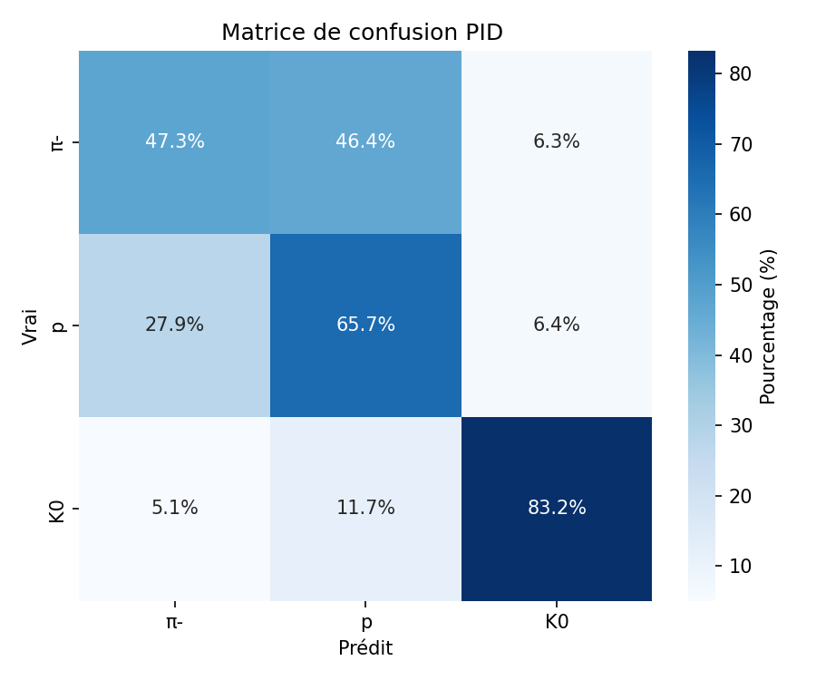
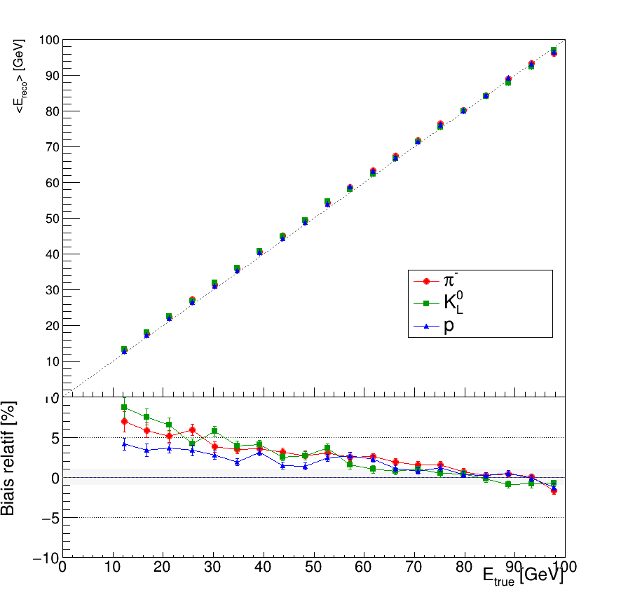
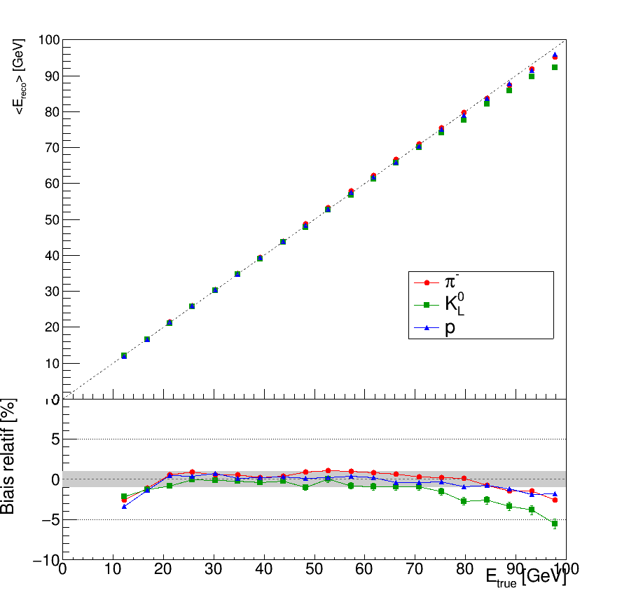

# SDHCAL Particle Identification and Energy Reconstruction

This repository contains my M2 internship research software for studying particle identification and energy reconstruction in a Semi-Digital Hadronic Calorimeter (SDHCAL). It combines ROOT/C++ shower-parameter extraction with machine-learning and chi2/TMinuit reconstruction studies for simulated hadronic showers, with an emphasis on clear analysis workflows rather than a production-ready experiment framework.

> **Continuing this work?** Start with the
> [project handover guide](docs/HANDOVER.md). It identifies the reference
> results, required external datasets, maintained entry points and priority
> tasks for the next student.

**Skills demonstrated**

- Particle-physics data analysis with ROOT/C++, LCIO-derived detector outputs, and shower observables.
- Supervised learning for hadron PID using LightGBM BDTs, scikit-learn MLPs, and exploratory graph neural networks.
- Energy reconstruction with both ML regressors and a semi-digital chi2/TMinuit calibration approach.
- Reproducible research organization: seeded splits, per-run configuration records, performance tables, and method comparisons.
- Scientific communication through documented pipelines, result summaries, and portfolio-oriented repository structure.
- Critical review of the analysis, with the main methodological limitations
  stated explicitly below.

## Project Overview

The SDHCAL is a highly granular hadronic calorimeter concept using semi-digital readout: each cell records threshold information rather than a fully analog energy deposit. This readout is well suited to imaging hadronic showers, but it also makes reconstruction dependent on shower topology, threshold occupancies, and calibration choices.

The project investigates two connected tasks:

1. **Particle identification (PID)** for simulated pi-, K0, and proton showers.
2. **Energy reconstruction** using shower features, semi-digital hit counts, and particle-dependent or particle-aware reconstruction strategies.

The repository is meant to show the analysis logic, code organization, and representative outputs from the internship. Large datasets and trained artifacts are not versioned.

## Physics Motivation

Hadronic calorimetry is challenging because hadron showers fluctuate strongly event by event. In a semi-digital detector, the information available per hit is compressed into threshold levels, so reconstruction relies on both counting information and spatial shower development. Useful PID and energy estimators can exploit:

- longitudinal shower development, such as first active layers, barycentres, RMS, and fitted profile quantities;
- transverse morphology, such as density, radius, eccentricity, and clustering;
- semi-digital threshold content, such as N1, N2, N3, Thr1, Thr2, Thr3, and threshold ratios;
- timing or timing-derived features where available;
- correlations between the particle hypothesis and the optimal energy reconstruction.

## Detector and Data Context

The analysis is based on simulated SDHCAL-like samples. The full upstream chain is external to this repository:

```text
SDHCAL simulation (.slcio)
        -> digitization (.slcio)
        -> LCIO to ROOT conversion
        -> shower-parameter extraction
        -> PID and energy reconstruction studies
```

The repository assumes ROOT trees containing either per-hit detector information
or derived shower parameters. Maintained scripts resolve their inputs through
`SDHCAL_DATA_DIR`, and write models and outputs through `SDHCAL_MODEL_DIR` and
`SDHCAL_OUT_DIR`. Legacy path literals are translated by the shared path layer.

## Main Objectives

- Extract physically interpretable shower variables from digitized calorimeter hits.
- Compare hadronic shower variables across particle species.
- Train and evaluate PID models for pi-, K0, and proton separation.
- Reconstruct incident energy using ML regression and chi2/TMinuit semi-digital calibration.
- Study how PID decisions affect downstream energy reconstruction.

## Methods

**Shower feature extraction**

- ROOT/C++ event loop over digitized hits.
- Computation of threshold counts, shower start, barycentre, RMS, density, radius, clustering, longitudinal-profile quantities, timing summaries, and topology features.
- Also written per event: `eventNumber`, so a held-out sample can be proved disjoint from the training events, and `touchesLastLayer`, so the machine-learning chain can apply the same containment cut as the chi2 chain.
- Main code: `analysis/1_shower_features/`.

**Particle identification**

- LightGBM BDT classifiers using engineered shower variables: `analysis/3_pid/bdt/train.py`.
- Class imbalance handled by SMOTE on the training split only, or by LightGBM class weights; when hyper-parameters are searched, the resampling runs inside each cross-validation fold.
- scikit-learn MLP baselines with standardization: `analysis/3_pid/mlp/`.
- Exploratory PyTorch Geometric GNN models using hit-level or graph-like shower representations.
- Main code: `analysis/3_pid/`.

**Energy reconstruction**

- LightGBM and MLP regressors trained on derived shower parameters, in log(E) with a bias-corrected back-transform: `train.py` and `ml_mlp/train.py`. The maintained two-class MLP accepts `pi`, `proton`, `mix-pi-proton`, or `all`.
- Semi-digital weighted least-squares calibration with TMinuit on the threshold multiplicities N1, N2, N3, fitted on a training split and evaluated on a held-out one.
- Main code: `analysis/4_energy/` and `analysis/4_energy/chi2_tminuit/`.

**PID-energy coupling**

- Three cases, quoted together: no PID at all (one inclusive regressor), perfect PID (routing by the true particle) and real PID (routing by the classifier).
- Main code: `analysis/5_pid_energy/study.py`, driven by `--pid` and `--reco`. See [its README](analysis/5_pid_energy/README.md).

## Repository Structure

```text
.
├── src/sdhcal/              Shared Python library, installed with `pip install -e .`
│                              data, models, predictions, configs, provenance, manifests
├── cpp/                     Shared C++ used by the ROOT stages
│   ├── include/                analysis, feature records and ROOT contracts
│   └── src/                    shared scientific calculation and ROOT I/O
│
├── analysis/                THE CHAIN, one directory per stage
│   ├── 1_shower_features/      digitized hits -> shower variables  (C++/ROOT)
│   ├── 2_variable_study/       how the variables differ by species (ROOT macros)
│   ├── 3_pid/                  bdt/ mlp/ gnn/ cnn/
│   ├── 4_energy/               ml_bdt/ ml_mlp/ chi2_tminuit/
│   ├── 5_pid_energy/           does identifying first help?
│   └── archive/                obsolete code and historical outputs
│
├── calibration/             chi2 coefficients: one file, read by C++ and Python
├── tools/                   utilities outside the chain (held-out sample, log repair)
├── tests/                   test suite for the shared library
├── docs/                    data-pipeline and validated-results documentation
├── results/                 frozen archive of the internship figures (see below)
├── report/                  M2 internship LaTeX report and compiled PDF (self-contained)
├── data/                    detector data, not versioned
│
├── Makefile                 make check, and one target per stage
├── pyproject.toml           package metadata, pytest and ruff configuration
├── requirements.txt         Python dependencies
└── CITATION.cff             Suggested citation metadata
```

The numbering of `analysis/` gives the reading order of the analysis chain.
Stages 3 and 4 are independent branches off stage 1 and stage 5 joins them; see
[analysis/README.md](analysis/README.md) for the diagram and the conventions
every stage shares.


See also:

Start here:

- [Project handover](docs/HANDOVER.md)
- [Data pipeline](docs/data_pipeline.md)
- [Execution and reproducibility](docs/reproducibility.md)
- [Results summary](docs/results_summary.md)

Provenance, without which no number here can be reproduced or defended:

- [Simulation provenance](docs/simulation_provenance.md) - Geant4 version, physics
  list, digitisation window and the two production configurations. Read it before
  quoting anything about the delayed shower component.
- [Figure provenance](docs/figures.md) - which command regenerates each figure of
  the report, and which three cannot be regenerated.
- [Characterisation baseline](docs/r0_baseline.md) - the behaviour frozen before
  the architectural refactoring, the log of deliberate contract changes, and the
  scientific questions those contracts explicitly do *not* validate.

Architecture of the shared package, written during the refactoring:

- [Configuration](docs/configuration.md) and [artifacts](docs/artifacts.md)
- [Tabular models](docs/tabular.md), [BDT](docs/bdt_architecture.md),
  [MLP](docs/mlp_architecture.md)
- [Hit-level models](docs/hit_architecture.md) and
  [hit-level energy](docs/hit_energy_architecture.md)
- [Prediction](docs/prediction_architecture.md) and
  [C++/ROOT](docs/cpp_root_architecture.md)

## Internship Report

The M2 internship report is included in [report/](report/) as a LaTeX project with its compiled PDF, [report/main.pdf](report/main.pdf). The report provides the longer scientific narrative behind the code: SDHCAL detector context, semi-digital calorimetry, hadronic shower variables, PID methods, energy reconstruction, and PID-energy coupling studies.

See [report/README.md](report/README.md) for the report structure and compilation instructions.

## Data Availability

The raw, digitized, converted ROOT files, generated CSV tables, trained models, and large intermediate arrays are not included in this repository. They are too large for GitHub and depend on external simulation and reconstruction environments.

In principle, the data chain depends on external tools such as SDHCAL simulation, digitization, LCIO/Marlin processing, ROOT, and local storage paths. Lightweight figures and selected performance summaries are kept in the repository when useful for review.

## Getting Started

```bash
make venv                 # create .venv, install the dependencies and the sdhcal package
source .venv/bin/activate
make check                # compile every source, run the tests, check the C++
```

Data locations come from the environment rather than from paths written into the
scripts:

```bash
export SDHCAL_DATA_DIR=/path/to/root/files      # inputs   (default: ./data)
export SDHCAL_MODEL_DIR=/path/to/models         # models   (default: ./models)
export SDHCAL_OUT_DIR=/path/to/output           # outputs  (default: ./output)
```

A missing dataset raises an error naming the variable to set, instead of failing
inside uproot. The expected layout under `SDHCAL_DATA_DIR` is declared in
[`src/sdhcal/paths.py`](src/sdhcal/paths.py).

## Running the Analyses

One target per stage of the chain, in order:

```bash
make features     # 1. digitized hits -> shower variables           (C++/ROOT)
make variables    # 2. compare the variables between species        (ROOT macros)
make pid          # 3. hadron identification                        (LightGBM)
make energy       # 4. energy reconstruction, ML and chi2
make coupling     # 5. does identifying first help? the three cases
```

`make help` lists every target. Arguments can be overridden without editing
anything:

```bash
make pid PID_ARGS="--no-timing"
make energy ENERGY_ARGS="--particles pi --seeds 10 --require-contained"
make test PYTHON=/path/to/python
make cpp ROOT_CONFIG=/path/to/root-config
```

Each target simply calls the stage's own script, so you can always call it
directly:

```bash
# 3. identification, with and without the timing variables
python analysis/3_pid/bdt/train.py --sigma-time 0.1 --seeds 5
python analysis/3_pid/bdt/train.py --no-timing

# 4. energy, per particle and with one inclusive regressor
python analysis/4_energy/ml_bdt/train.py --particles all --seeds 5
python analysis/4_energy/ml_bdt/train.py --particles mixed
root -l -b -q 'analysis/4_energy/chi2_tminuit/fit.C("pi")' && make calibration

# 5. the coupling study: these three numbers belong in the same table
python analysis/5_pid_energy/study.py --pid none --reco bdt   # no PID
python analysis/5_pid_energy/study.py --pid true --reco bdt   # perfect PID
python analysis/5_pid_energy/study.py --pid bdt  --reco bdt   # real PID
```

Every run writes its full configuration - feature list, smearing width, seeds,
git commit, package versions - to `$SDHCAL_OUT_DIR/<study>/runs/*.json`, so a
figure can be traced back to the configuration that produced it. See
[analysis/README.md](analysis/README.md) for the conventions every stage shares.
For future published result sets, `tools/create_release.py` writes a portable
manifest under `results/<release-id>/` without moving or duplicating the existing
models and predictions -- a release manifest beside the frozen archive, not a
figure copied into it. Explicit run selection, environment snapshots and the
manifest schema are documented in
[docs/reproducibility.md](docs/reproducibility.md).

## Representative Results and Figures

The figures below are examples of outputs currently stored in the repository. The
final report uses the validated PID results and the event-level energy biases,
while treating the historical width curves as qualitative dispersion indicators.

The results retained in the final report are:

- a multiclass LightGBM balanced accuracy of **67.8 %**, with recalls of
  **48.8 %** for pi-, **68.6 %** for protons and **86.0 %** for K0. The sample
  carries PDG code 311, a flavour eigenstate, not the 130 of a K0L; about 1.2 %
  of those events are purely electromagnetic, the signature of a K0S decay;
- the pion/proton confusion of **47.9 %** established as a property of the
  showers rather than of the models: pion and proton start their showers in the
  same layer with the same spread, where the neutral kaon starts six layers
  deeper, and neither a CNN nor a graph network reading the hits improves on the
  shower descriptors;
- a binary pion/proton balanced accuracy of **61.3 ± 0.1 %** over five seeds;
- a cluster-level DeepSets correction to the semi-digital calibration that lowers
  the stochastic term from **54.4 ± 1.2 %** to **46.3 ± 0.6 %** over four seeds,
  where every descriptor-based estimator sits at the same floor;
- hit timing at 100 ps shown to act on the stochastic term alone, and only below
  about 25 GeV; no saturation below 100 ps is established;
- **routing by species buys nothing** once the regressor is trained on the
  mixture: sigma/E is 0.1199 with no label, 0.1201 with the predicted label and
  0.1199 with the true one. What routing does fix is the scale error of a pion
  calibration applied to protons, worth -4.9 % to -0.4 % of proton bias at 20 GeV.

<p align="center">
  
  
  
</p>

### Where figures live

Three directories, with three different statuses, which is worth stating plainly:

| Directory | Status |
|---|---|
| `output/` | Everything a run writes, under `$SDHCAL_OUT_DIR`. Not versioned, regenerable by construction, and each run carries its own `runs/<id>.json`. |
| `report/Fig/` | Versioned. The figures the report compiles against, written by `make report-figures`, which copies them out of `output/benchmark/` under the names the LaTeX expects. This is the maintained path from a run to a published figure. |
| `results/` | Versioned, and **frozen**. The internship figures, produced before runs were logged; no current run reproduces them, and none of their filenames exists under `output/`. Kept as a record and for the images shown above, not as a destination for new figures. |

One exception survives: `analysis/4_energy/ml_bdt/plots/` holds six committed
figures beside the script that wrote them, including one shown above. They
belong in `results/` by the convention stated in
[analysis/archive/README.md](analysis/archive/README.md); they are left where
the report's links already point at them.

Which figure in the report comes from which macro, and the three that cannot be
regenerated at all, are listed in [docs/figures.md](docs/figures.md).

Additional useful figure locations:

- `results/pid/bdt/feature-interpretation/` - LightGBM feature-importance, SHAP-style summaries, and tree visualizations.
- `analysis/archive/results/3_pid/gnn/plots/` - historical GNN training and confusion-matrix plots.
- `analysis/4_energy/ml_bdt/plots/` - ML energy linearity, relative deviation, and resolution plots.
- `analysis/archive/results/4_energy/ml_mlp/results_*_energy_reco/plots/` - historical MLP regression curves. The per-particle folders are not trustworthy: the three scripts that wrote them were identical and all read the pion file.
- `results/energy-reconstruction/chi2-tminuit/summary-plots/` - chi2/TMinuit reconstruction profiles and diagnostics.
- `results/shower-variables/plots/` - shower-variable overlays and comparisons.
- `results/pid-energy-coupling/summary/` - PID-energy coupling summary confusion matrices.
- `analysis/archive/results/*/plots/` - historical coupling comparisons. What is labelled "no PID" there is in fact perfect PID; see [analysis/5_pid_energy/README.md](analysis/5_pid_energy/README.md).

## Limitations

Read these before quoting any number from this repository.

- **The legacy result figures predate the code corrections.** In particular,
  the width curves use an uncorrected 90 %-truncated RMS and must not be read as
  an absolute measurement of sigma. The final report therefore uses them only
  for qualitative comparisons and reports bias separately from dispersion.
- **The chi2-versus-ML comparison is now like-for-like.** The calibration
  coefficients are fitted out of sample, and every estimator is evaluated on the
  same events under the same containment selection.
- **The PID-agnostic baseline has been measured.** The scripts named `noPID_*`
  had routed events by the true particle, so what was compared was real PID
  against perfect PID. The missing cell, an inclusive regressor with no label at
  all, reverses the reading: see the routing result above.
- **Only one model carries a measured training variance in full.** The cluster
  network was repeated on four seeds for the 100 ps energy configuration; the
  other timing points and the cluster-level PID models are still single-seed, and
  their comparisons should be read accordingly.
- **The final DRD6 results use disjoint training and evaluation samples.** The
  corresponding ROOT inputs are not versioned in this repository, so their
  separation cannot be replayed from a fresh checkout. New runs use
  `tools/build_holdout.py --check` and an event-level manifest to enforce and
  record the same separation automatically.
- **Per-particle MLP energy results should be disregarded.** The three scripts
  that were supposed to produce them were byte-identical, read the pion file,
  and did not run at all.
- **Legacy figures cannot all be attributed to an exact configuration**, because
  the feature list and the smearing width were never logged and the run logs
  were column-shifted. The logs are repaired and new runs record everything, but
  the older figures cannot be reconstructed after the fact.
- The large input datasets are not included, so direct reruns need the
  simulation chain.
- The GNN and CNN studies are exploratory and no result in the report depends on
  them.

## Future Improvements

- Re-run every study with the corrected estimators and publish a single
  benchmark table with uncertainties from the multi-seed runs.
- Scan the timing resolution instead of fixing sigma = 0.1 ns, now that the
  smearing is independent per variable and configurable.
- Validate and, if appropriate, publish a fully locked cross-platform scientific
  environment beyond the Linux/Python 3.11 reference constraints used in CI.
- Treat `Begin = 48` as a categorical "not found" flag for the neural models
  rather than an extreme numerical value.

## Citation

If this repository is useful for orientation or comparison, please cite it using the metadata in [CITATION.cff](CITATION.cff). The repository represents internship research software, not a peer-reviewed publication.

## Contact

**Author:** IDIR Mohamed Yanis

**Email:** yanis.idr@outlook.fr
